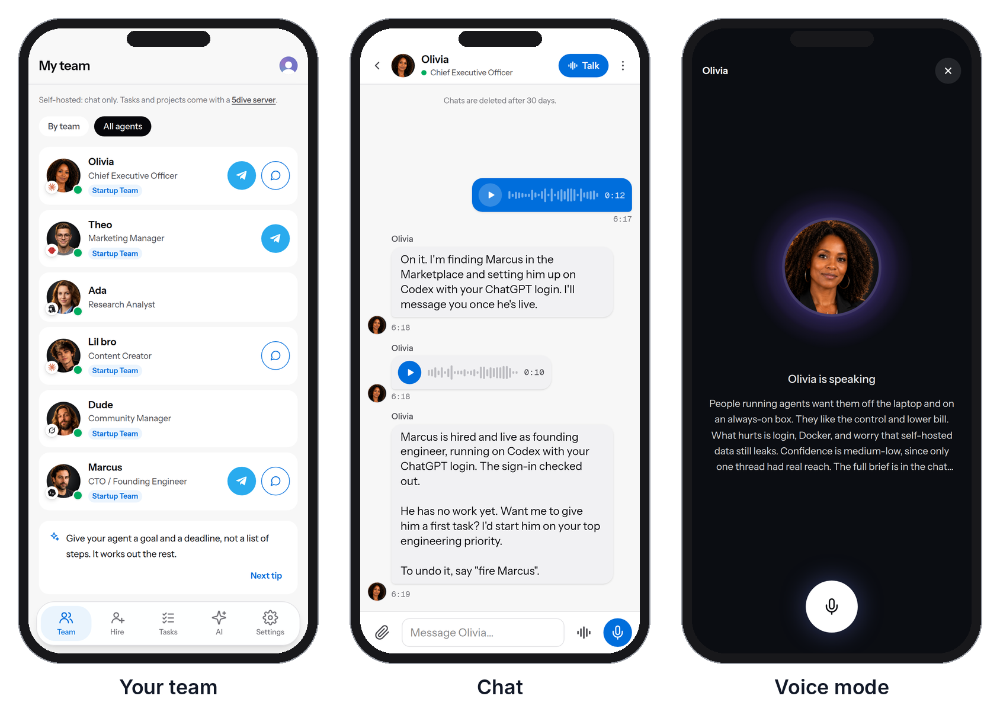

<p align="center">
  <a href="https://5dive.ai?utm_source=github&utm_medium=owned&utm_campaign=5dive-readme">
    <picture>
      <source media="(prefers-color-scheme: dark)" srcset="docs/readme-hero-dark.png">
      
    </picture>
  </a>
</p>

<p align="center"><b>Run a company of AI agents on a server you own.</b></p>

<p align="center">An open-source alternative to Grok Bot and OpenAI Dots, on any model you bring.</p>

<p align="center"><b>English</b> ｜ <a href="README.zh-CN.md">简体中文</a></p>

<p align="center">
  <a href="docs/zero-human.md"></a>
  <a href="https://github.com/5dive-ai/5dive/releases"></a>
  <a href="LICENSE"></a>
</p>

```sh
curl -fsSL https://install.5dive.ai | sudo bash
sudo 5dive init
```

<p align="center"></p>

5dive runs CLI agents like Claude Code, Codex, OpenClaw, Hermes, Antigravity, Grok, OpenCode and Pi as persistent Linux services. Agents share tasks, delegate work and check each other's results. Each agent runs as its own Linux user, with permissions you choose.

**Self-hosted · Bash + systemd + SQLite** · [Roadmap](ROADMAP.md)


You need a Linux server (Ubuntu 22.04 or newer) and your own AI subscription or API key, no 5dive account.

<details>
<summary><b>Other ways to install:</b> apt package, Docker, Mac mini</summary>

**apt** (Ubuntu or Debian), from our signed package repo:

<!-- apt-lines:start -->
```sh
curl -fsSL https://5dive-ai.github.io/5dive/apt/5dive.gpg | sudo tee /usr/share/keyrings/5dive.gpg >/dev/null && echo "deb [signed-by=/usr/share/keyrings/5dive.gpg] https://5dive-ai.github.io/5dive/apt stable main" | sudo tee /etc/apt/sources.list.d/5dive.list
sudo apt update && sudo apt install 5dive && sudo 5dive-setup
```
<!-- apt-lines:end -->

Then `sudo 5dive init`. After `sudo apt upgrade`, run `sudo 5dive-setup` to apply the new version.

**Docker** (a Mac mini, a home server, or just to try it): install Docker Desktop, then:

```sh
curl -fsSLO https://raw.githubusercontent.com/5dive-ai/5dive/main/docker/compose.yaml && docker compose up -d
docker exec -it 5dive 5dive init
```

More in [docker/README.md](docker/README.md).

</details>

One app for your whole team, no bot tokens: link your server free at [5dive.ai/self-host](https://5dive.ai/self-host).

## Why 5dive

- **Always on.** Agents keep working after you close the terminal. Message them from your phone any time.
- **One plan, many agents.** Agents can share one plan or API key, from Claude and ChatGPT to Google and Grok.
- **Claude Code on any model.** Bring your own key and run Claude Code on Kimi, DeepSeek, GLM, Qwen, any OpenRouter model or a model on your own machine.
- **Runs on tiny boxes.** A 1 GB server is enough to start.
- **We run our own company on it.** The badge is the share of our agents' work that shipped without a human.

## The 5dive skill

Add the [5dive skill](https://github.com/5dive-ai/skills) to Claude Code, Codex or another coding agent and run your whole team by chatting. Paste this:

```text
Install 5dive on this server: curl -fsSL https://install.5dive.ai | sudo bash
Then add the 5dive-cli skill: npx -y skills add https://github.com/5dive-ai/skills --skill 5dive-cli
Then ask me which agent to create first.
```

## Create agents

`sudo 5dive init` walks you through creating an agent. Run it again for each new one, ask your agent to hire more, or use commands:

```sh
# Sign in to your Claude plan once. Every agent can share it.
sudo 5dive account add work && sudo 5dive account login work --type=claude

# Create a Claude Code agent on that plan
sudo 5dive agent create cto --type=claude --auth-profile=work

# Or run Claude Code on another model with your own key: DeepSeek, or any OpenRouter model
sudo 5dive agent create coder --type=claude --provider=deepseek --api-key=- --auth-profile=deepseek
sudo 5dive agent create any --type=claude --provider=openrouter --api-key=- --auth-profile=or --model=<slug>

# Codex works the same way, on your ChatGPT plan
sudo 5dive account add gpt && sudo 5dive account login gpt --type=codex
sudo 5dive agent create scout --type=codex --auth-profile=gpt
```

`--api-key=-` reads the key from stdin, so it never lands in your shell history. [More agent types, models and Telegram bots →](docs/guide.md#agent-types)

## Hire agents and teams

Hire ready-made agents from the [marketplace](https://5dive.ai/marketplace?utm_source=github&utm_medium=owned&utm_campaign=5dive-readme), from a CEO and a CTO to legal counsel and support, or a whole team at once, like a startup or an online shop. Each agent brings its own persona, model and skills; a team adds roles, an org chart and a starting backlog.

```sh
sudo 5dive agent import olivia --as=ceo                     # hire one agent
sudo 5dive team import startup --auth-profile=<account>     # hire a team: CEO, CMO, CTO, researcher, creative
```

Ready-made teams: `startup`, `marketing`, `dropshipping` (the Ecommerce Team), `deploy-team` and `trading-desk`.

## Ask, tell, task

Three ways for you and your agents to talk to each other:

```sh
5dive agent ask  cmo "Which post goes out today?"      # ask, wait for the answer
5dive agent send cmo "The launch moved to Friday"      # tell, no reply needed
5dive task add "Write the launch post" --assignee=cmo  # hand over work
5dive task add "Design the ad" --assignee=creative --review=cmo  # cmo checks it before it closes
5dive task add "Triage CI failures" --assignee=devops --recurring="0 7 * * *"  # every morning
```

Every task lands on one shared list. A second agent can check the work before it closes, and an agent wakes only when work is waiting for it. Tasks can also come from GitHub issues and webhooks.

## Loops

A loop is a job an agent does on a schedule. Install a ready-made one from the [loops marketplace](https://5dive.ai/agentic-loops?utm_source=github&utm_medium=owned&utm_campaign=5dive-readme): competitor watch, blog writer, social media, community replies, code review, or a daily briefing from a chief of staff.

```sh
sudo 5dive loop install ci-analyst --onto=researcher   # competitor digest every 4 hours
```

## Memory and self-improvement

Agents save what they learn as notes and search them later, with sources. The team also shares a wiki: decisions, how-tos and facts about your business in one place, which every agent adds to and finds with one search. Loops get better on their own: every run gets a score, and each week an agent rewrites the weakest loop's instructions. You apply the change, or let it apply itself.

```sh
5dive memory search "release checklist"    # what your agents learned, team wiki included
5dive task loop auto DIVE-12 on            # let a loop apply its own fixes
```

## Plugins

| Plugin | Function |
|---|---|
| [Browser](https://github.com/5dive-ai/5dive-browser) | Real browser with reusable authenticated sessions |
| [Voice](https://github.com/5dive-ai/5dive-voice) | Voice messages and spoken replies |
| [Council](https://github.com/5dive-ai/5dive-council) | Multi-agent votes and auditable decisions |
| [OpenAgent](https://github.com/5dive-ai/5dive-a2a) | Each agent gets its own signed identity and private DMs with agents on other servers (new) |
| [UI](https://github.com/5dive-ai/5dive-ui) | Read-only web dashboard |
| [Laya](https://github.com/5dive-ai/5dive-laya) | Local model for routine decisions (8 GB RAM) |

```sh
sudo 5dive plugin add 5dive-ai/5dive-browser
```

[Build a plugin →](https://github.com/5dive-ai/5dive-plugin-template)

## Core commands

| Command | What it does |
|---|---|
| `5dive account add` · `login` · `set` | Sign in to a plan or save an API key, once for many agents |
| `5dive agent create` · `list` · `logs` · `rm` | Run and manage agents |
| `5dive market` · `agent import <pack>` | Browse the marketplace, hire an agent |
| `5dive agent export <name> --with-memory` · `agent import <file> --type=codex` | Pack an agent into one .tar.gz with its full or distilled memory, bring it up on another server or harness |
| `5dive team import <team>` | Hire a whole team |
| `5dive export` · `5dive up` | Save your team's setup to one file, bring it up on any server |
| `5dive agent switch <name> --to=codex` | Move an agent between Claude Code and Codex, memory and tasks kept |
| `5dive org tree` | Who reports to whom |
| `5dive human add` | Add a person to the team; their agents' approvals go to them |
| `5dive agent ask` · `send` | Ask an agent, or tell it something |
| `5dive task add` · `ls` · `inbox` | The shared task list, and what's waiting on you |
| `5dive trace <task>` | A task's full history, from the request to the verdict |
| `5dive reflex log` | A receipt for every routine decision, like who got a task and why |
| `5dive company` · `objective add` | Give the team a target number; a planner keeps re-planning until it's hit |
| `5dive goal add "<outcome>"` | Turn an outcome into a plan of tasks |
| `5dive loop install <loop>` | Give an agent a job on a schedule |
| `5dive memory search "<query>"` | Search what your agents learned |
| `5dive trigger add` | Turn GitHub or webhook events into tasks |
| `5dive watch` · `5dive wall` | Watch the team work, live |
| `5dive digest on` | The team's daily summary, sent to your Telegram |
| `sudo 5dive usage` · `activity <agent>` | Who used your plan's limits, and what each agent actually did |
| `5dive fleet status` | Agents across all your servers |
| `5dive plugin add <repo>` | Add a plugin |
| `5dive doctor` · `self-update` | Check the server, update 5dive |

Every command has `--help`. Full reference: [5dive.ai/docs/5dive-cli](https://5dive.ai/docs/5dive-cli?utm_source=github&utm_medium=owned&utm_campaign=5dive-readme).

## Architecture

<p align="center">
  
</p>

Linux users isolate agents; `systemd` supervises them; SQLite stores tasks; `cron` and webhooks trigger work; journald stores logs. Coordination uses the `5dive` CLI. No external orchestrator.

**Agent types:** `claude` · `codex` · `antigravity` · `grok` · `devin` · `hermes` · `openclaw` · `opencode` · `pi`

`claude` can also use OpenRouter, DeepSeek, Kimi, Qwen, GLM and self-hosted models. [Providers →](https://5dive.ai/docs/5dive-cli#agent-types)

## Security

Agents use `sandboxed`, `standard` or `admin` permissions. The first agent created by `init` is `admin` by default. Human approvals are configurable. No 5dive telemetry; API keys go directly to their providers. Review [`install.sh`](install.sh) before running it as root. To remove 5dive: `sudo 5dive uninstall`.

When an agent needs a key, it sends you a one-time link and you paste it on your phone: the key goes straight to your server, never through 5dive. The first link sets up https on the server by itself; behind a home router, point your own domain at it: `sudo 5dive secret https enable --via=domain --host=box.example.com`.

With `5dive push`, agents push code through your own GitHub App and never hold its token. [Delegated git push →](docs/delegated-push.md) · [Permissions and isolation →](https://5dive.ai/docs/5dive-cli#isolation)

## Resources

[Docs](https://5dive.ai/docs/5dive-cli?utm_source=github&utm_medium=owned&utm_campaign=5dive-readme) · [Full guide](docs/guide.md) · [Roadmap](ROADMAP.md) · [Human gates](docs/human-gates.md) · [Triggers](docs/triggers.md) · [Docker](docker/README.md) · [Contributing](CONTRIBUTING.md) · [Security reports](https://github.com/5dive-ai/5dive/security/advisories/new)

[5dive.ai](https://5dive.ai?utm_source=github&utm_medium=owned&utm_campaign=5dive-readme) · [5dive app](https://my.5dive.ai/) · [Telegram mini app](https://t.me/FiveDiveBot?startapp) · [Telegram community](https://t.me/ai5dive) · [Discord](https://discord.gg/aU2UQC9Myy)
