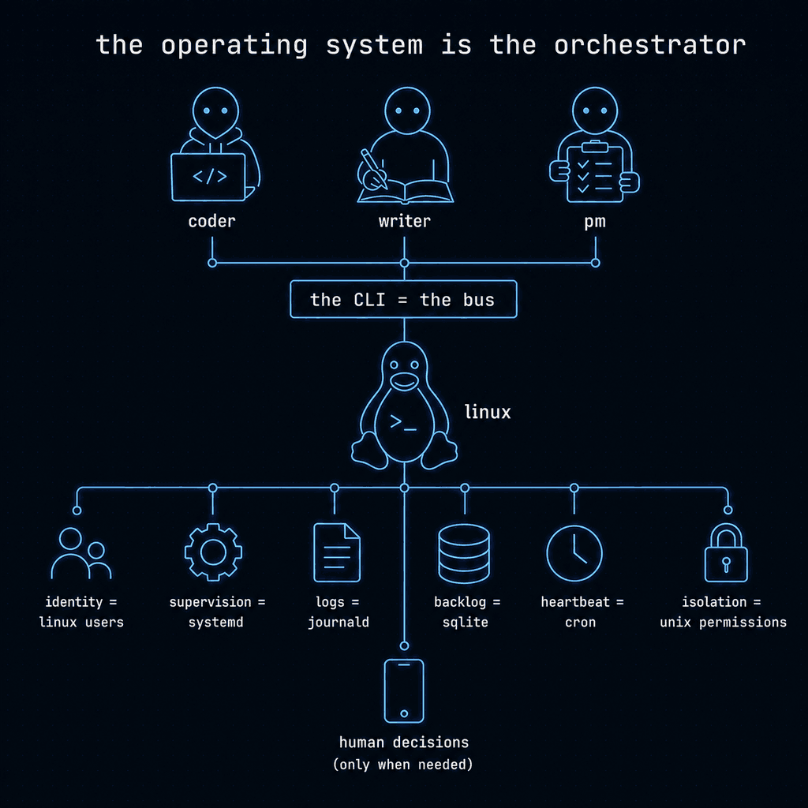

<!-- README.zh-CN.md — 简体中文 (DIVE-799)。2026-10-20 与 README.md 同步（DIVE-6623）。英文原文见 README.md。 -->

<p align="center">
  <a href="https://5dive.ai?utm_source=github&utm_medium=owned&utm_campaign=5dive-readme-zh">
    <picture>
      <source media="(prefers-color-scheme: dark)" srcset="docs/readme-hero-dark.png">
      
    </picture>
  </a>
</p>

<p align="center"><b>在你自己的服务器上，运行一家由 AI 智能体组成的公司。</b></p>

<p align="center"><a href="README.md">English</a> ｜ <b>简体中文</b></p>

<p align="center">
  <a href="docs/zero-human.md"></a>
  <a href="https://github.com/5dive-ai/5dive/releases"></a>
  <a href="LICENSE"></a>
  <a href="https://t.me/ai5dive"></a>
</p>

```sh
curl -fsSL https://install.5dive.ai | sudo bash
sudo 5dive init
```

5dive 把 Claude Code、Codex 等命令行智能体作为常驻的 Linux 服务运行。智能体共享任务、互相分派工作，并检查彼此的结果。每个智能体都有自己的 Linux 用户和可配置的权限。

**自托管 · Bash + systemd + SQLite · MIT**


你只需要一台 Linux 服务器，以及你自己的 AI 订阅或 API key，无需 5dive 账号。不想自己运维服务器？[托管版 5dive](https://5dive.ai?utm_source=github&utm_medium=owned&utm_campaign=5dive-readme-zh) 替你运行。

## 为什么选 5dive

- **一直在线。** 关掉终端后，智能体照常工作。随时在 Telegram 上给它们发消息。
- **一个套餐，多个智能体。** 多个智能体可以共用一个 Claude 或 OpenAI 订阅或 API key。中间不经过我们。
- **小机器也能跑。** 一台 1 GB 内存的服务器就能跑一个智能体。
- **我们自己的公司就跑在它上面。** 顶部徽章显示：过去 30 天里，我们的智能体无需人工介入就交付的工作占比。

## 5dive 技能

把 [5dive 技能](https://github.com/5dive-ai/skills)加到 Claude Code 或 Codex，就能通过聊天管理整支团队。把下面这段粘贴给它：

```text
在这台服务器上安装 5dive：curl -fsSL https://install.5dive.ai | sudo bash
然后添加 5dive-cli 技能：npx -y skills add https://github.com/5dive-ai/skills --skill 5dive-cli
然后问我先创建哪个智能体。
```

## 雇用智能体和团队

[市场](https://5dive.ai/marketplace?utm_source=github&utm_medium=owned&utm_campaign=5dive-readme-zh)里有 36 个现成的智能体，从 CEO、CTO 到法律顾问、客服和会计，每个都有自己的人设、模型和技能。也可以用一条命令雇用整支团队，自带角色、组织架构和初始任务清单。

```sh
sudo 5dive agent import olivia --as=ceo     # 雇用一个智能体
sudo 5dive team import startup              # 雇用一支团队：CEO、CMO、DevOps、研究员、创意设计
```

现成的团队：`startup`、`content-studio`、`eng-studio`、`deploy-team`、`distribution`，以及打造 5dive 的那支团队 `5dive-team`。

## 询问、告知、派任务

你和你的智能体之间有三种沟通方式：

```sh
5dive agent ask  cmo "今天发哪篇帖子？"        # 询问，等待回答
5dive agent send cmo "发布改到周五了"          # 告知，无需回复
5dive task add "写发布公告" --assignee=cmo     # 分派工作
5dive task add "设计广告" --assignee=creative --review=cmo  # 关闭前由 cmo 检查
5dive task add "排查 CI 失败" --assignee=devops --recurring="0 7 * * *"  # 每天早上
```

所有任务都会进入同一个共享列表。任务关闭前可以由第二个智能体检查，智能体只在有工作等着它时才会被唤醒。任务也可以来自 GitHub issue 和 webhook。

## 循环（Loops）

循环是智能体定时执行的一项工作。可以从[循环市场](https://5dive.ai/agentic-loops?utm_source=github&utm_medium=owned&utm_campaign=5dive-readme-zh)安装现成的循环：竞品监控、博客写作、社交媒体、社区回复、代码审查，或由幕僚长发出的每日简报。

```sh
sudo 5dive loop install ci-analyst --onto=researcher   # 每 4 小时一份竞品摘要
```

## 记忆与自我改进

智能体把学到的东西记成笔记（附来源），之后可以检索。对所有人都有用的经验会写进团队 wiki，每个智能体都能检索。循环会自我改进：每次运行都会得到评分，每周由一个智能体改写得分最低的循环的指令。改动可以由你来应用，也可以让它自动应用。

```sh
5dive memory search "发布清单"              # 你的智能体学到了什么，包括团队 wiki
5dive task loop auto DIVE-12 on            # 让循环自动应用自己的改进
```

## 核心命令

| 命令 | 作用 |
|---|---|
| `5dive agent create` · `list` · `logs` | 运行和管理智能体 |
| `5dive agent import <pack>` | 从市场雇用一个智能体 |
| `5dive team import <team>` | 雇用整支团队 |
| `5dive org tree` | 谁向谁汇报 |
| `5dive agent ask` · `send` | 询问智能体，或告诉它一件事 |
| `5dive task add` · `ls` · `inbox` | 共享任务列表，以及等你处理的事 |
| `5dive trace <task>` | 一个任务从提出到结论的完整历史 |
| `5dive goal add "<outcome>"` | 把一个目标拆成一组任务 |
| `5dive loop install <loop>` | 给智能体一项定时工作 |
| `5dive memory search "<query>"` | 搜索智能体学到的东西 |
| `5dive trigger add` | 把 GitHub 或 webhook 事件变成任务 |
| `5dive watch` · `5dive wall` | 实时观看团队工作 |
| `5dive digest on` | 团队每日摘要，发到你的 Telegram |
| `sudo 5dive usage` | 哪些智能体和任务在消耗你的套餐额度 |
| `5dive fleet status` | 你所有服务器上的智能体 |
| `5dive plugin add <repo>` | 添加插件 |
| `5dive doctor` · `self-update` | 检查服务器，更新 5dive |

每个命令都支持 `--help`。完整参考（英文）：[5dive.ai/docs/5dive-cli](https://5dive.ai/docs/5dive-cli?utm_source=github&utm_medium=owned&utm_campaign=5dive-readme-zh)。

## 插件

| 插件 | 功能 |
|---|---|
| [Browser](https://github.com/5dive-ai/5dive-browser) | 真实浏览器，可复用已登录的会话 |
| [Voice](https://github.com/5dive-ai/5dive-voice) | 语音消息和语音回复 |
| [Council](https://github.com/5dive-ai/5dive-council) | 多智能体投票和可审计的决策 |
| [A2A](https://github.com/5dive-ai/5dive-a2a) | 带签名的跨服务器智能体消息（实验性） |
| [UI](https://github.com/5dive-ai/5dive-ui) | 只读 Web 仪表盘 |
| [Laya](https://github.com/5dive-ai/5dive-laya) | 处理日常决策的本地模型（8 GB 内存） |

```sh
sudo 5dive plugin add 5dive-ai/5dive-browser
```

[开发一个插件 →](https://github.com/5dive-ai/5dive-plugin-template)

## 架构

<p align="center">
  
</p>

Linux 用户隔离智能体；`systemd` 负责进程守护；SQLite 存储任务；`cron` 和 webhook 触发工作；journald 保存日志。协作通过 `5dive` CLI 完成。不依赖外部编排器。

**智能体类型：** `claude` · `codex` · `antigravity` · `grok` · `devin` · `hermes` · `openclaw` · `opencode` · `pi`

`claude` 也可以使用 OpenRouter、DeepSeek、Kimi、通义千问、智谱 GLM 和自托管模型。[模型提供商 →](https://5dive.ai/docs/5dive-cli#agent-types)

## 安全

智能体使用 `sandboxed`、`standard` 或 `admin` 权限。`init` 创建的第一个智能体默认是 `admin`。人工审批可以配置。5dive 不收集遥测数据；API key 直接发给各自的模型提供商。以 root 运行 [`install.sh`](install.sh) 之前，请先审阅它。

使用 `5dive push` 时，智能体通过你自己的 GitHub App 推送代码，从不持有它的 token。[委托 git push →](docs/delegated-push.md) · [权限与隔离 →](https://5dive.ai/docs/5dive-cli#isolation)

## 资源

[文档（英文）](https://5dive.ai/docs/5dive-cli?utm_source=github&utm_medium=owned&utm_campaign=5dive-readme-zh) · [完整指南（英文）](docs/guide.md) · [人工审批](docs/human-gates.md) · [触发器](docs/triggers.md) · [Docker](docker/README.md) · [参与贡献](CONTRIBUTING.md) · [报告安全漏洞](https://github.com/5dive-ai/5dive/security/advisories/new)

[托管版 5dive](https://5dive.ai?utm_source=github&utm_medium=owned&utm_campaign=5dive-readme-zh) · [Telegram 应用](https://t.me/FiveDiveBot?startapp) · [Telegram 社区](https://t.me/ai5dive) · [Discord](https://discord.gg/aU2UQC9Myy)
