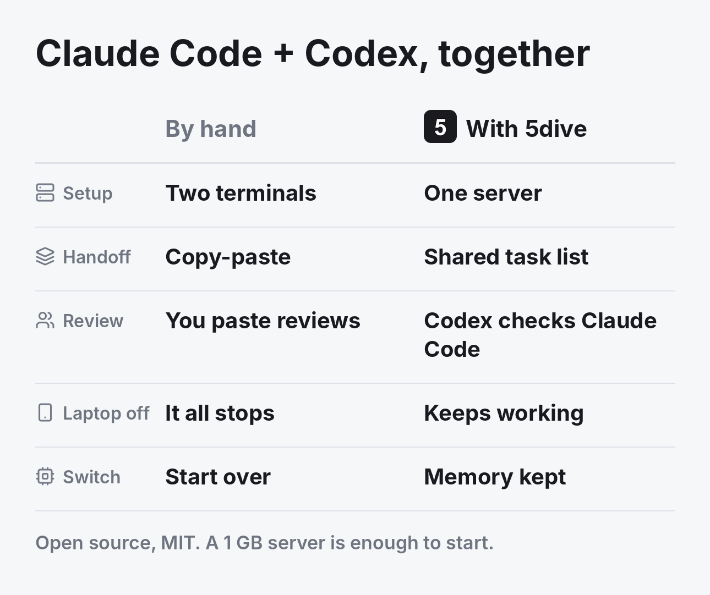

# Run Claude Code and Codex together on one server



**Short answer:** install 5dive on a Linux server and sign in once each to your Claude plan and your ChatGPT plan. Then create agents on each. They run as separate Linux services, share one task list and can check each other's work. 5dive is open source (MIT) and free to self-host.

## Set it up

```sh
curl -fsSL https://install.5dive.ai | sudo bash

# Sign in once per plan. Every agent on it shares the plan.
sudo 5dive account add work && sudo 5dive account login work --type=claude
sudo 5dive account add gpt && sudo 5dive account login gpt --type=codex

# One Claude Code agent, one Codex agent
sudo 5dive agent create cto --type=claude --auth-profile=work
sudo 5dive agent create scout --type=codex --auth-profile=gpt
```

## Make them work together

```sh
5dive task add "Fix the checkout bug" --assignee=cto --review=scout   # Codex checks it before it closes
5dive agent ask scout "What's left before the release?"
```

Every task lands on one shared list. An agent wakes only when work is waiting for it.

## What you get

| | |
|---|---|
| Plans | Your Claude and ChatGPT plans, shared across agents, or an API key |
| Isolation | Each agent is its own Linux user, with permissions you choose |
| Teamwork | One task list, handoffs, and a second agent that checks the work |
| Switching | Move an agent from Claude Code to Codex and back, memory and tasks kept |
| Usage | `sudo 5dive usage` shows who used your plan's limits |
| Phone | Web app at [5dive.ai/self-host](https://5dive.ai/self-host) |

The same team can also run Hermes, OpenClaw, OpenCode, Pi and more, or Claude Code on DeepSeek, Kimi or a local model.

A 1 GB server is enough to start. The code is at [github.com/5dive-ai/5dive](https://github.com/5dive-ai/5dive).

More comparisons:

- [Grok Bot vs OpenAI Dots vs 5dive](grok-bot-vs-openai-dots.md)
- [OpenClaw vs Hermes Agent vs 5dive](openclaw-vs-hermes.md)
- [A self-hosted Grok Bot alternative](grok-bot-alternative.md)
