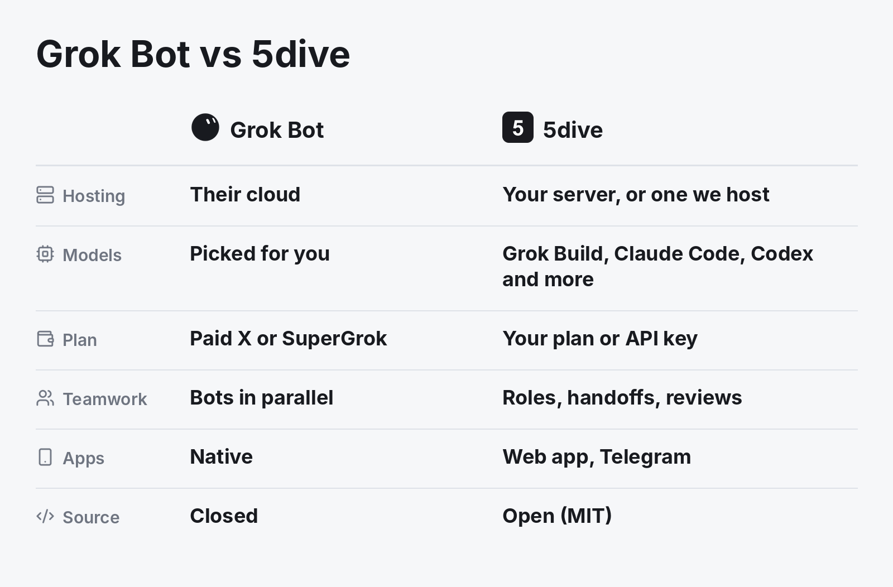

# A self-hosted Grok Bot alternative



**Short answer:** 5dive runs the real Grok Build CLI on your xAI account or API key, as an always-on agent on your own Linux server. It works on one task board with Claude Code, Codex, Hermes and other agents. 5dive is open source (MIT). No server? We host one for you.

## Grok Bot and 5dive side by side

| | Grok Bot | 5dive |
|---|---|---|
| Runs on | Cursor-hosted cloud computers | Your Linux server, or one we host |
| Model | Picked for each task | Grok Build, Claude Code, Codex, Hermes, OpenClaw and more |
| You need | A paid X or SuperGrok plan | Your own AI plan or API key |
| Several agents | Bots work in parallel on one shared computer | A team with roles on one task board, where one agent can check another's work |
| Apps | Native desktop and mobile | Web app and Telegram |
| Source | Closed | MIT |

## Pick Grok Bot if

you want hosted computers with nothing to set up, and you're happy for it to pick the model.

## Pick 5dive if

you want your agents on your own server, want Grok Build writing the code while Claude Code reviews it, or want to read and change the code. The core is bash, systemd and sqlite.

## Start

```sh
curl -fsSL https://install.5dive.ai | sudo bash
sudo 5dive init
```

Pick Grok when `init` asks, sign in with your xAI account and name the agent. Run `init` again to add Claude Code as its reviewer. Our own team has finished 5,700 tasks this way since July.

No server? We host one for you. Start a free trial at [5dive.ai](https://5dive.ai). The code is at [github.com/5dive-ai/5dive](https://github.com/5dive-ai/5dive).

---

Sources, checked 2026-10-29 to 2026-11-07: Grok Bot's overview, FAQ, plans and security pages; the 5dive README; a fresh-server install test of Grok on 5dive 0.121.0 (2026-11-06).

More comparisons:

- [Grok Bot vs OpenAI Dots vs 5dive](grok-bot-vs-openai-dots.md)
- [Run Claude Code and Codex together](claude-code-and-codex-together.md)
- [OpenClaw vs Hermes Agent vs 5dive](openclaw-vs-hermes.md)
