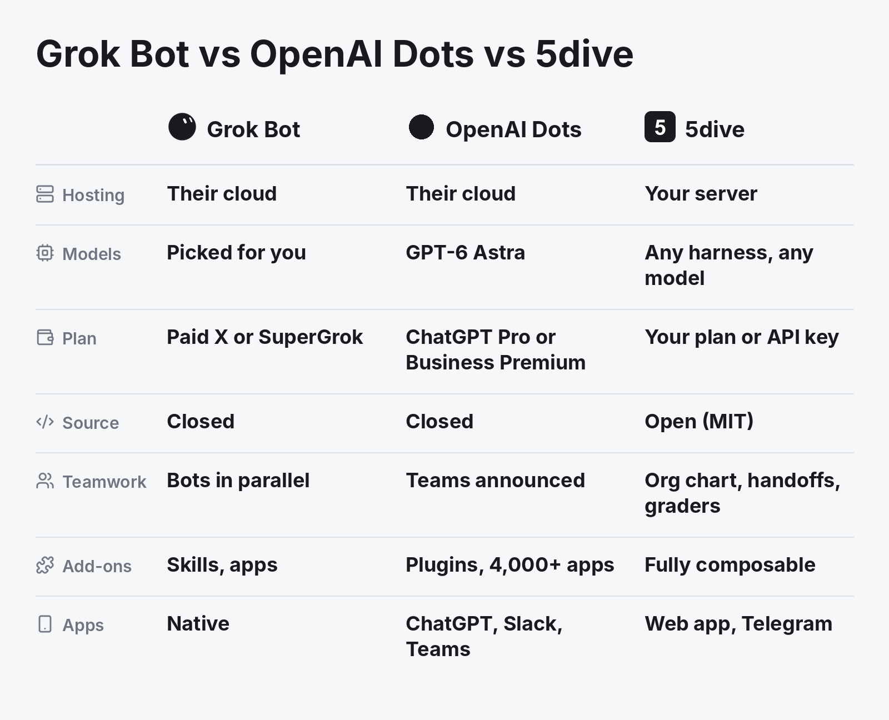

# Grok Bot vs OpenAI Dots vs 5dive



**Short answer:** Grok Bot and OpenAI Dots are cloud agents that come with a subscription. 5dive is open source (MIT). It runs real agent CLIs like Claude Code and Codex as one team on your own server, on the AI plans or API keys you already have.

## At a glance

| | Grok Bot | OpenAI Dots | 5dive |
|---|---|---|---|
| Runs on | Cursor-hosted cloud computers | A cloud computer for each dot | Your Linux server, or one we host |
| Model | Picked for each task | GPT-6 Astra | Your pick: Claude Code, Codex, Hermes, OpenClaw and more |
| You need | A paid X or SuperGrok plan | ChatGPT Pro or Business Premium | Nothing. Bring your own AI plan or API key |
| Several agents | Yes, Bots work in parallel on one shared computer | Teams of dots announced for later | Yes, a team on one task board, each agent its own Linux user |
| Add-ons | Skills and connected apps | Plugins, 4,000+ apps | Plugins and custom CLI commands |
| Apps | Native desktop and mobile | ChatGPT, Slack, Teams | Web app and Telegram. Android and iOS coming |
| Source | Closed | Closed | MIT |

## Pick Grok Bot if

you already pay for X or SuperGrok and want native apps with nothing to set up.

## Pick OpenAI Dots if

you're on ChatGPT Pro or Business Premium and your work lives in ChatGPT, Slack or Teams.

## Pick 5dive if

you want the agents on your own server, want Claude Code and Codex working together on plans you already pay for, or want a team that hands work to each other and checks it before it closes.

## Start

```sh
curl -fsSL https://install.5dive.ai | sudo bash
sudo 5dive init
```

A 1 GB server is enough to start. Link it to the web app at [5dive.ai/self-host](https://5dive.ai/self-host). The code is at [github.com/5dive-ai/5dive](https://github.com/5dive-ai/5dive).

---

Sources, checked 2026-10-29 to 2026-11-02: Grok Bot's overview, FAQ and security pages; The Next Web's coverage of OpenAI DevDay 2026; the 5dive README.

More comparisons:

- [Run Claude Code and Codex together](claude-code-and-codex-together.md)
- [OpenClaw vs Hermes Agent vs 5dive](openclaw-vs-hermes.md)
- [A self-hosted Grok Bot alternative](grok-bot-alternative.md)
