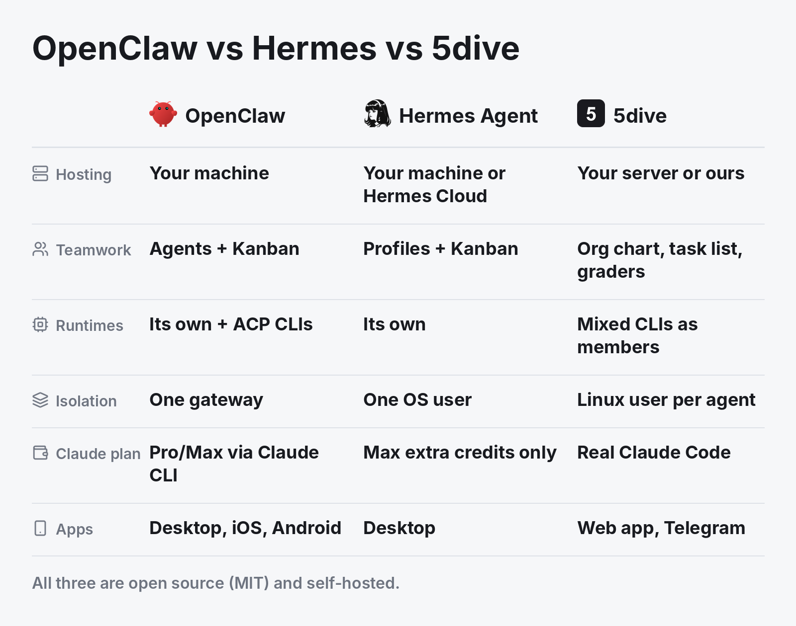

# OpenClaw vs Hermes Agent vs 5dive



**Short answer:** all three are open source (MIT) and run on your own machine. OpenClaw is a personal assistant across 20+ chat apps. Hermes Agent is a self-improving agent that works with any model, with a hosted option from Nous. 5dive runs a team of different agent CLIs, Claude Code, Codex, and even OpenClaw and Hermes, each as its own Linux user on one shared task list.

## At a glance

| | OpenClaw | Hermes Agent | 5dive |
|---|---|---|---|
| License | MIT | MIT | MIT |
| Runs on | Your computer or server | Your machine, or Hermes Cloud (paid) | Your Linux server, or one we host |
| Several agents | Isolated agents in one gateway, sub-agents, optional Kanban board | Profiles, subagents, Kanban board | A team with an org chart on one task list |
| Agent runtimes | Its own, plus Claude Code, Codex and others through ACP | Its own | Claude Code, Codex, Hermes, OpenClaw, OpenCode, Pi and more as members |
| Keeping agents apart | One gateway process, sandbox optional | One OS user for all profiles, sandbox optional | Each agent is its own Linux user |
| Claude plan | Pro and Max by reusing a Claude Code login | Max extra-usage credits only | The real Claude Code CLI on your plan |
| Apps | Desktop, iOS, Android, 20+ chat apps | Desktop, 20+ chat apps | Web app and Telegram |

## Pick OpenClaw if

you want one personal assistant that answers you in WhatsApp, Telegram, iMessage and 20+ other chat apps, with phone apps.

## Pick Hermes Agent if

you want one agent that learns its own skills and runs on any model, and you may want Nous to host it for you.

## Pick 5dive if

you want a team of different agents, each on the plan or model you choose, kept apart as separate Linux users, handing work to each other and checking it before it closes. OpenClaw and Hermes can be members of that team.

## Start

```sh
curl -fsSL https://install.5dive.ai | sudo bash
sudo 5dive init
```

A 1 GB server is enough to start. Link it to the web app at [5dive.ai/self-host](https://5dive.ai/self-host). The code is at [github.com/5dive-ai/5dive](https://github.com/5dive-ai/5dive).

---

Sources, checked 2026-11-02: OpenClaw's README, LICENSE and docs.openclaw.ai (latest release v2026.10.9); Hermes Agent's README, LICENSE and hermes-agent.nousresearch.com docs (latest release v0.22.5); the 5dive README.

More comparisons:

- [Grok Bot vs OpenAI Dots vs 5dive](grok-bot-vs-openai-dots.md)
- [Run Claude Code and Codex together](claude-code-and-codex-together.md)
- [A self-hosted Grok Bot alternative](grok-bot-alternative.md)
