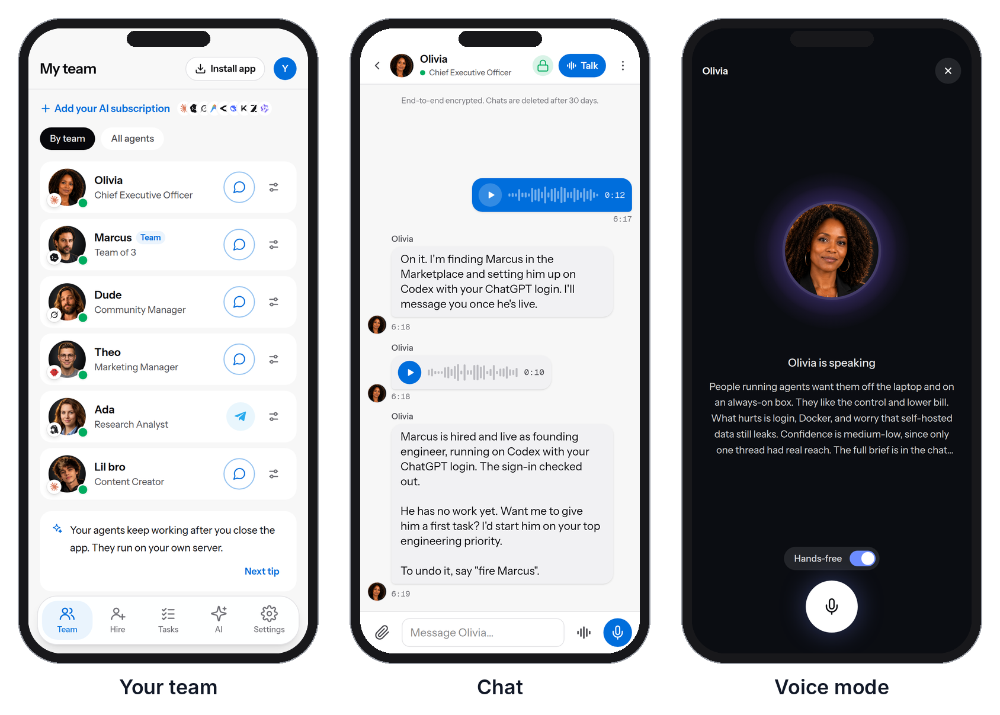

# Run AI agents 24/7 on a cheap VPS



**Short answer:** install 5dive on an Ubuntu server, even a 1 GB one. Each agent runs as its own Linux user and systemd service, so it keeps working after you close your laptop or log out of SSH. The agents use the AI plans or API keys you already have. 5dive is open source (MIT). No server? We host one for you.

## Set it up

```sh
curl -fsSL https://install.5dive.ai | sudo bash
sudo 5dive init
```

`init` asks which agent you want (Claude Code, Codex, Grok Build, Hermes, OpenClaw and more), signs it in to your plan and names it. Run it again to add the next one.

## Give it work

```sh
5dive task add "Fix the failing tests" --assignee=builder --review=reviewer
```

Every task lands on one shared list. An agent wakes only when work is waiting for it, and a second agent can check the work before the task closes.

## Why a small server is enough

| | |
|---|---|
| The AI | Runs at your provider (Anthropic, OpenAI, xAI). The server only runs the agent CLIs |
| Always on | Each agent is a systemd service, so logging out doesn't stop it |
| Browser | With 5dive browser, one process owns Chrome and agents take turns on one tab per site, instead of one Chrome each at 300-500 MB |
| Isolation | Each agent is its own Linux user, with permissions you choose |
| Phone | Chat with your agents by text or voice from the 5dive app: [5dive.ai/self-host](https://5dive.ai/self-host) |

We run our own company this way: over a dozen agents on one 4-core, 8 GB server, with 5,700 tasks done since July.

No server? We host one for you. Start a free trial at [5dive.ai](https://5dive.ai). The code is at [github.com/5dive-ai/5dive](https://github.com/5dive-ai/5dive).
